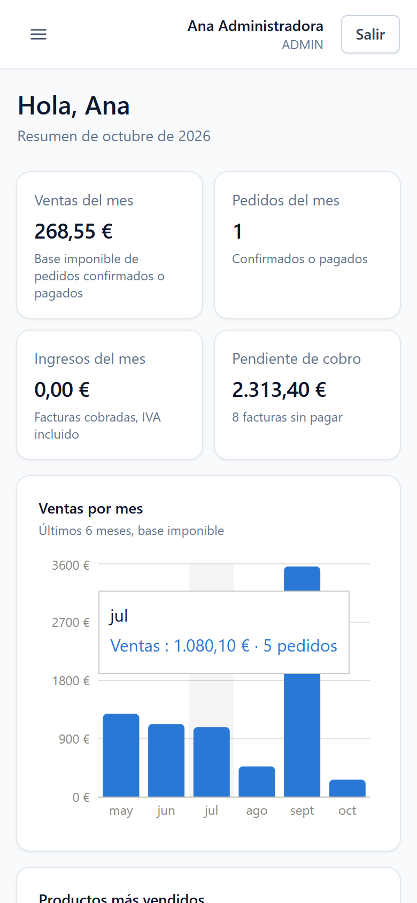
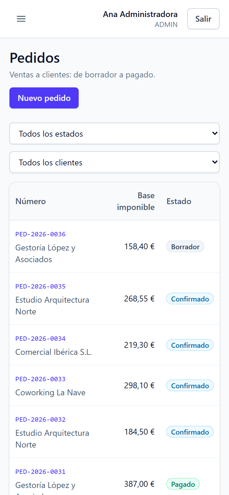
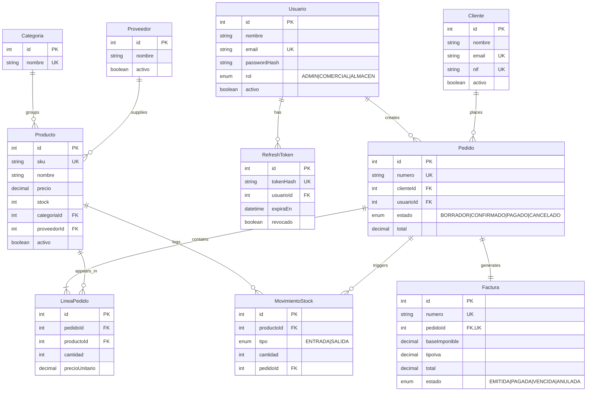

# WarehouseProject

🌐 English version (this page) · **[Versión en castellano](README.md)**

[](https://github.com/Paul-Gomez/WarehouseProject/actions/workflows/ci.yml)

Lightweight ERP for a small shop or warehouse: catalog and inventory with a stock movement
ledger, customers and suppliers, multi-line orders that deduct stock atomically, VAT invoicing
with PDF export, role-based users, and a business metrics dashboard.

This is the flagship project of my portfolio: a complete application (REST API + SPA) with a
relational database, integration tests, Docker, and CI.


## Features

- **JWT authentication** with a 15-minute access token and a refresh token rotated on every use.
- **Three roles** (ADMIN, COMERCIAL = sales, ALMACEN = warehouse): everyone can read, and each
  role writes only what it's responsible for. The backend always enforces it; the frontend
  hides what you can't do.
- **Catalog**: products, categories, and suppliers, with search, filters, pagination, and soft
  delete (anything with history is deactivated, not deleted).
- **Inventory**: every stock entry or exit is recorded in a movement ledger, so the stock level
  can always be explained. Warehouse staff record restocks, shrinkage, and adjustments.
- **Orders**: draft → confirmed → paid (or cancelled). Confirming deducts stock for every line
  in a single transaction; cancelling returns it.
- **Invoices**: issued from an order, they store base, VAT, and total, can be downloaded as PDF,
  and automatically become *overdue* once the due date passes.
- **Dashboard**: month sales and income, outstanding receivables, 6-month sales, best-selling
  products, low stock, and orders by status.

## Screenshots

| | |
|---|---|
|  |  |
|  |  |
|  |  |

On mobile, secondary columns are hidden and the essentials move under the main value:

<p>
  
  
</p>

(The UI is in Spanish, the language of the business domain.)

## Stack

| Layer        | Technology                                                       |
| ------------ | ---------------------------------------------------------------- |
| Backend      | Node.js · Express 5 · TypeScript (strict mode)                   |
| Database     | PostgreSQL 16 · Prisma                                           |
| Validation   | Zod (backend and frontend)                                       |
| Security     | JWT · bcrypt · helmet · login rate limiting · CORS               |
| Frontend     | React 19 · TypeScript · Vite · Tailwind CSS                      |
| State        | TanStack Query (server data) · Context (session)                 |
| Forms        | React Hook Form + Zod                                            |
| Charts       | Recharts                                                         |
| PDF          | pdfkit                                                           |
| Tests        | Jest · Supertest (against real PostgreSQL) · Vitest (frontend)   |
| Containers   | Docker · Docker Compose · nginx                                  |
| CI           | GitHub Actions (lint, formatting, types, tests, build, images)   |
| Deployment   | Render (API + PostgreSQL) · Vercel (frontend)                    |

## Architecture

```
warehouse-project/
├── backend/            REST API
│   ├── prisma/         schema, migrations, and seed
│   ├── src/
│   │   ├── modules/    one module per resource: routes → controller → service → repository
│   │   ├── middlewares/  authentication, roles, validation, errors, login rate limit
│   │   └── config/     environment variables (validated with Zod) and Prisma
│   └── tests/          Supertest integration tests
├── frontend/           React SPA
│   └── src/
│       ├── api/        React Query hooks per resource
│       ├── pages/      one folder per screen
│       └── components/ reusable components (table, modal, pagination…)
├── docs/capturas/
└── docker-compose.yml  PostgreSQL + API + frontend behind nginx
```

- **Layered backend.** Routes only chain middlewares; the controller translates HTTP; the
  service holds the business logic and opens transactions; the repository is the only layer
  that talks to Prisma. Repositories receive the transaction client, so the service decides
  what belongs to one transaction without the repository knowing about it.
- **Centralized error handling.** Every error ends up in a single middleware that always
  returns the same shape: Zod errors → 400, business errors → 404/409, and Prisma errors
  (unique key, foreign key) translated — never a stack trace.
- **Monorepo without workspaces**: two independent npm projects in one repository.

## Key technical decisions

- **Race-free stock.** Stock is deducted with a single
  `UPDATE … SET stock = stock - n WHERE stock >= n`, and state transitions with
  `UPDATE … WHERE status = X`. If two people confirm the last item at the same time, one wins
  and the other gets a 409: stock never goes negative. A test checks this by firing both
  requests concurrently.
- **All or nothing.** Confirming an order is a single transaction: if any line lacks stock,
  everything is rolled back, including what was already deducted for earlier lines.
- **No deadlocks.** Lines are always processed ordered by product, so two orders sharing
  products lock rows in the same order.
- **Sequential numbering** (`PED-2026-0001`, `FAC-2026-0001`) under a PostgreSQL advisory lock,
  so two simultaneous creations never get the same number.
- **Money as `NUMERIC`**, never floating point, with explicit VAT rounding.
- **Snapshots**: each order line stores the price at that moment and each invoice its amounts,
  so history doesn't change when prices or the VAT rate change.
- **Rotated, hashed refresh tokens.** Each refresh token works once; if someone steals one and
  uses it, the legitimate user's next refresh fails. On the frontend, if several requests
  expire at once, they share a single renewal.
- **Frontend performance**: each page is downloaded when first visited (initial bundle went
  from 885 kB to 350 kB; Recharts is only fetched when the dashboard is opened).

## Data model



Full schema: [`backend/prisma/schema.prisma`](backend/prisma/schema.prisma). Model and field
names are in Spanish on purpose: it's the language of the business domain.

## API

Every route (except login, refresh, and logout) requires `Authorization: Bearer <accessToken>`.
Any authenticated user can read; writing depends on the role.

| Resource                | Main endpoints                                                              | Who can write          |
| ----------------------- | --------------------------------------------------------------------------- | ---------------------- |
| Authentication          | `POST /api/auth/login` · `refresh` · `logout` · `GET /api/auth/yo`          | —                      |
| Users                   | `POST /api/auth/registrar` (no public sign-up)                              | ADMIN                  |
| Categories              | CRUD on `/api/categorias`                                                   | ADMIN                  |
| Suppliers and customers | CRUD on `/api/proveedores` and `/api/clientes`                              | ADMIN, COMERCIAL       |
| Products                | CRUD on `/api/productos`                                                    | ADMIN, ALMACEN         |
| Stock                   | `GET`/`POST /api/productos/:id/movimientos`                                 | ADMIN, ALMACEN         |
| Orders                  | CRUD on `/api/pedidos` · `POST /:id/confirmar` · `/pagar` · `/cancelar`     | ADMIN, COMERCIAL       |
| Invoices                | `GET /api/facturas` · `POST /api/facturas` · `/:id/anular` · `GET /:id/pdf` | ADMIN, COMERCIAL       |
| Dashboard               | `GET /api/dashboard`                                                        | —                      |

Lists accept `page` and `pageSize` and return `{ data, meta: { page, pageSize, total, totalPages } }`.

## Getting started

### With Docker (full stack)

Requirements: Docker.

```bash
docker compose up -d --build
docker compose --profile seed run --rm seed   # sample data
```

Open http://localhost:8080. Sample users (password `Password123!`):
`admin@warehouseproject.dev`, `comercial@warehouseproject.dev`, and `almacen@warehouseproject.dev`.

The API applies migrations on startup, and nginx serves the frontend and proxies `/api` to the backend.

### Locally (for development)

Requirements: Node.js 20.12+ and Docker (only for PostgreSQL).

```bash
docker compose up -d postgres

cd backend
npm install
cp .env.example .env          # and generate your own JWT secrets
npm run prisma:migrate
npm run prisma:seed
npm run dev                   # http://localhost:3000

cd ../frontend
npm install
npm run dev                   # http://localhost:5173 (proxies /api to the backend)
```

Environment variables are documented in [`backend/.env.example`](backend/.env.example) and
validated with Zod on startup: if one is missing, the API refuses to start and says which one.

## Tests

```bash
cd backend
npm test
```

36 Supertest integration tests against a PostgreSQL test database (`warehouseproject_test`,
created and migrated automatically): authentication and roles, token rotation, orders
(rollback, concurrency, numbering), stock, invoices, overdue handling, and PDF.

```bash
cd frontend
npm test
```

Vitest unit tests for the frontend's pure logic (currently, money formatting). The screens
have been checked by hand at 360, 768, 1024, 1280, and 1440 px.

## CI

Every push runs on GitHub Actions: lint, formatting, type checking, tests (with a PostgreSQL
service container), and build for the backend; lint, formatting, types, tests, and build for
the frontend; and building both Docker images.

## Deployment

- **API + database on Render**: the repository includes a blueprint ([`render.yaml`](render.yaml)).
  In Render: *New → Blueprint* and pick the repository. It creates the database, generates the
  JWT secrets, and deploys the backend Docker image.
- **Frontend on Vercel**: import the repository with `frontend` as the root directory and set
  `VITE_API_URL` to the public API URL. [`frontend/vercel.json`](frontend/vercel.json) makes SPA
  routes work on reload.
- Finally, in Render, set `CORS_ORIGIN` to the Vercel URL.

## Roadmap

- [x] **Phase 0** — Initial setup (structure, TypeScript, ESLint + Prettier)
- [x] **Phase 1** — Data modeling (ER diagram, Prisma, migrations, seed)
- [x] **Phase 2** — Catalog CRUD with a layered architecture
- [x] **Phase 3** — JWT authentication and role-based authorization
- [x] **Phase 4** — Orders, atomic stock deduction, and invoicing
- [x] **Phase 5** — Frontend base (layout, protected routes, login)
- [x] **Phase 6** — Frontend CRUD with pagination and filters
- [x] **Phase 7** — Dashboard with metrics and charts
- [x] **Phase 8** — Invoice PDFs, stock movements, tests, Docker, and CI
- [x] **Phase 9** — Production hardening, deployment, and documentation

### Possible next steps

- Corrective invoices (a voided invoice currently can't be re-issued).
- Remote search in the order form selectors (they currently load up to 100 items).
- Frontend end-to-end tests (Playwright).

## License

MIT
