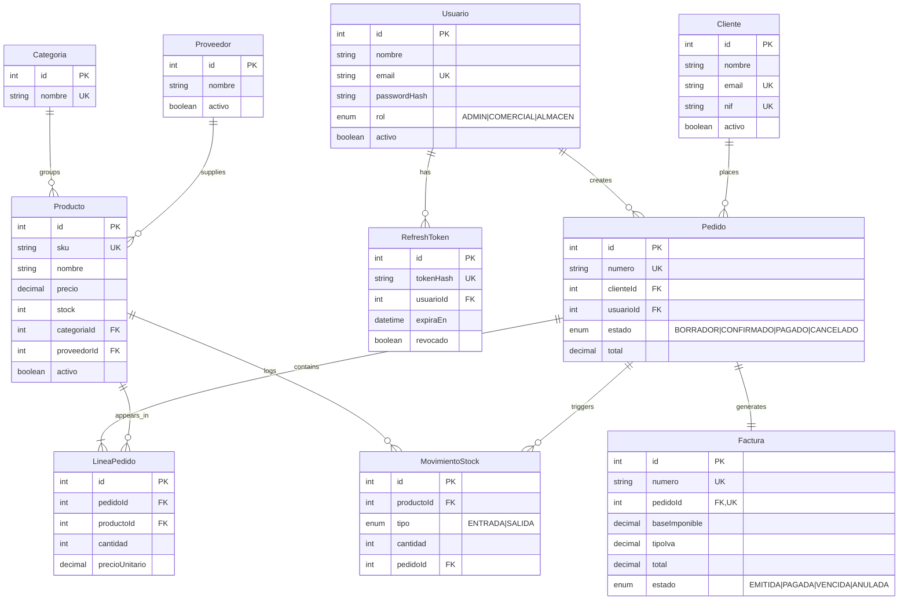

# WarehouseProject

🌐 English version (this page) · **[Versión en castellano](README.md)**

Lightweight ERP for managing a small shop/warehouse: product and inventory catalog,
customers and suppliers, multi-line orders, VAT invoicing, role-based users, and a
business metrics dashboard.

Built as the flagship project of a developer portfolio to demonstrate backend, frontend,
relational database design, and good practices (layered architecture, validation,
authentication, tests, Docker, and CI).

## Stack

| Layer            | Technology                                              |
| ----------------- | -------------------------------------------------------- |
| Backend           | Node.js · Express · TypeScript                           |
| ORM                | Prisma                                                   |
| Database           | PostgreSQL                                               |
| Validation         | Zod                                                      |
| Authentication      | JWT (access token + refresh token)                       |
| Frontend           | React · TypeScript · Tailwind CSS                        |
| Charts             | Recharts                                                 |
| Backend tests       | Jest · Supertest                                         |
| Containers          | Docker · Docker Compose                                  |
| CI                 | GitHub Actions (lint + tests on every push)               |
| PDF invoices        | pdfkit                                                   |

## Repository structure

```
warehouse-project/
├── backend/     REST API (Express + Prisma)
└── frontend/    React SPA (added in Phase 5)
```

It's a **monorepo with two independent npm projects**, not a workspace. Each project has
its own `package.json`, its own `tsconfig.json`, and its own lifecycle. For a project this
size, that avoids the complexity of setting up npm/pnpm workspaces without losing the
benefit of keeping the whole history in a single repository.

## Roadmap by phase

- [x] **Phase 0** — Initial setup (structure, TypeScript, ESLint + Prettier, README)
- [x] **Phase 1** — Data modeling (ER diagram, Prisma schema, migrations, seed)
- [x] **Phase 2** — Backend: CRUD for Product, Category, Customer, and Supplier
- [x] **Phase 3** — Backend: JWT authentication and role-based authorization
- [ ] **Phase 4** — Backend: orders, atomic stock deduction, and invoicing
- [ ] **Phase 5** — Frontend: base (layout, protected routes, login)
- [ ] **Phase 6** — Frontend: connected CRUD with pagination and filters
- [ ] **Phase 7** — Frontend: dashboard with metrics and charts
- [ ] **Phase 8** — Invoice PDFs, tests, Docker Compose, and CI
- [ ] **Phase 9** — Final polish, documentation, and deployment

## Data model

Design decisions:

- Monetary amounts as `NUMERIC` (`Decimal` in Prisma), never floating point.
- Order lines and invoices store **snapshots** of price and VAT: historical data doesn't
  change even if the product's price later changes.
- Order lifecycle: `DRAFT → CONFIRMED → PAID` (or `CANCELLED`). Stock is deducted on
  confirmation, inside an atomic transaction (Phase 4).
- Append-only stock movement ledger (`MovimientoStock`) for traceability; `Producto.stock`
  is a cached value derived from it.
- Soft delete (`activo`) in the catalog; historical foreign keys use `RESTRICT`.
- `RefreshToken` is its own table (not a field on `Usuario`): enables real logout and
  simultaneous sessions across multiple devices.

> Note: model and field names in the schema (`Usuario`, `Pedido`, `activo`...) are kept in
> Spanish on purpose, matching the domain language of the original brief — the same way a
> team would keep business terms in the language their stakeholders use.

### Entity-relationship diagram



Full schema: [`backend/prisma/schema.prisma`](backend/prisma/schema.prisma).

## Getting started (development)

Requirements: Node.js 20+ and Docker (for PostgreSQL).

```bash
# 1. Start PostgreSQL
docker compose up -d

# 2. Backend
cd backend
npm install
cp .env.example .env
npm run prisma:migrate   # creates the DB and applies migrations
npm run prisma:seed      # loads sample data
npm run dev
```

The API runs at `http://localhost:3000`. Quick check: `GET /health`.

`npm run prisma:studio` opens a visual database browser at `http://localhost:5555`.

## Authentication and authorization

JWT with a short-lived access token (15 min) + a long-lived refresh token (7 days), with
**rotation**: every `POST /api/auth/refresh` invalidates the refresh token that was used
and issues a new one, so a stolen refresh token that gets reused by an attacker leaves a
trace (the legitimate owner's next refresh fails).

| Endpoint                   | Public | Description                                         |
| --------------------------- | :----: | ----------------------------------------------------- |
| `POST /api/auth/login`      |   ✅    | Returns `accessToken` + `refreshToken`                |
| `POST /api/auth/refresh`    |   ✅    | Rotates the refresh token, returns a new pair          |
| `POST /api/auth/logout`     |   ✅    | Revokes a refresh token                                |
| `GET /api/auth/yo`          |   ❌    | Current authenticated user's data                      |
| `POST /api/auth/registrar`  |   ❌    | `ADMIN` only: creates users (no public self-registration) |

Protected routes: every endpoint under `/api/categorias`, `/api/proveedores`,
`/api/clientes`, and `/api/productos` requires `Authorization: Bearer <accessToken>`.
Reading (`GET`) only requires being authenticated; writing requires a specific role,
matching who manages that resource in real life:

| Resource   | Write role              |
| ---------- | ------------------------ |
| Category   | `ADMIN`                  |
| Supplier   | `ADMIN`, `COMERCIAL`     |
| Customer   | `ADMIN`, `COMERCIAL`     |
| Product    | `ADMIN`, `ALMACEN`       |

## License

MIT
