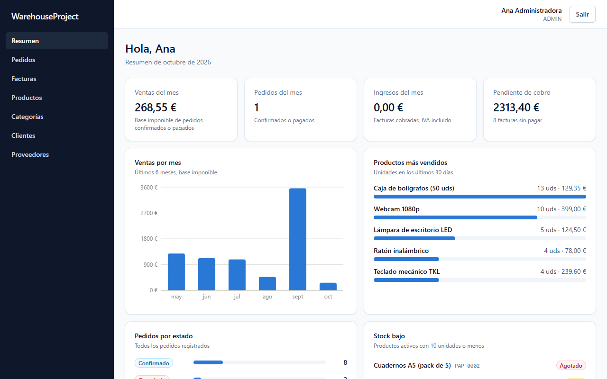
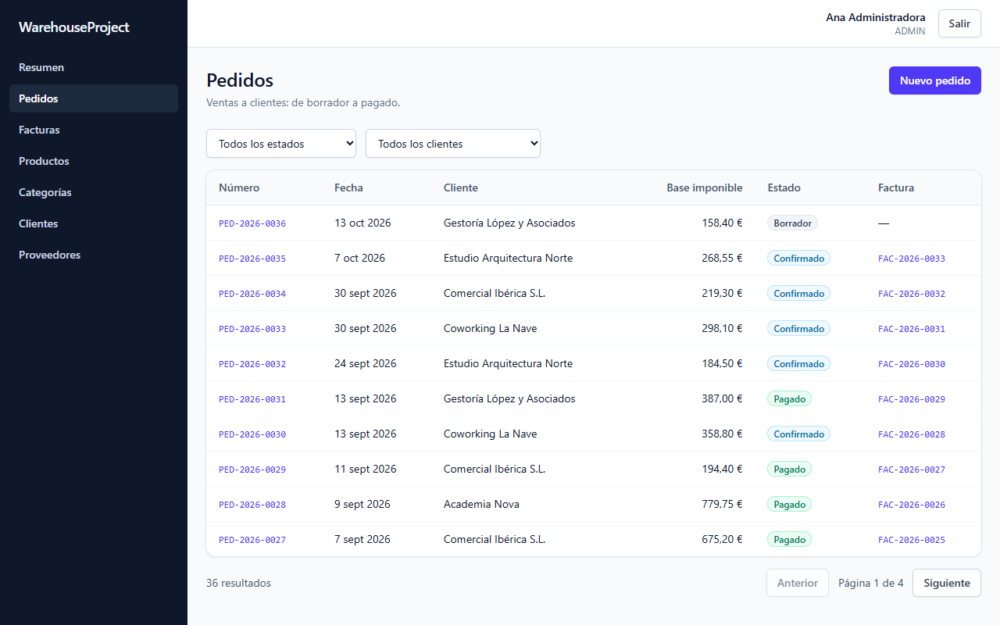
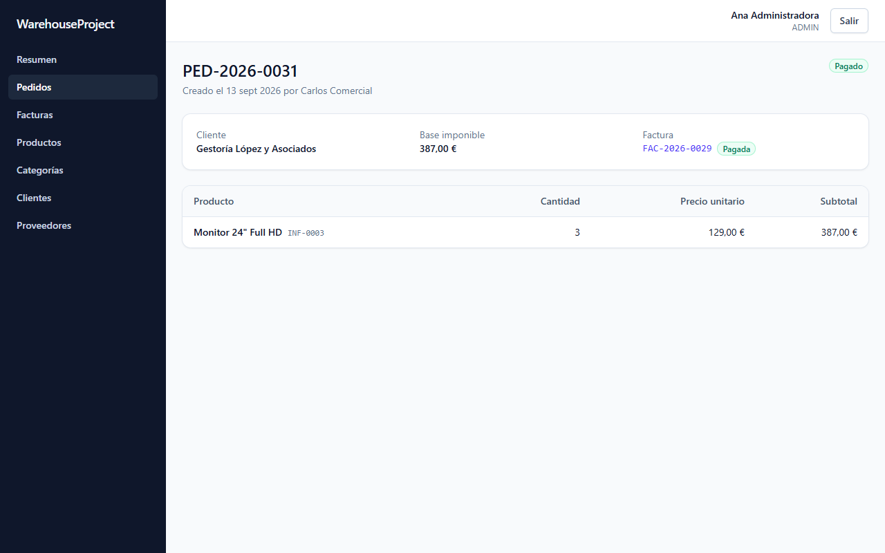
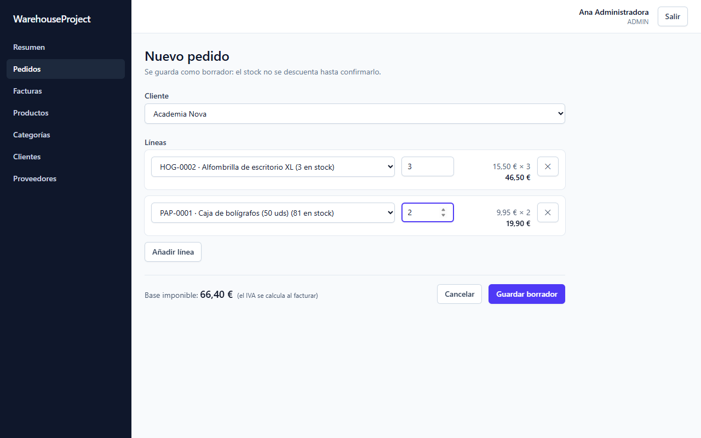
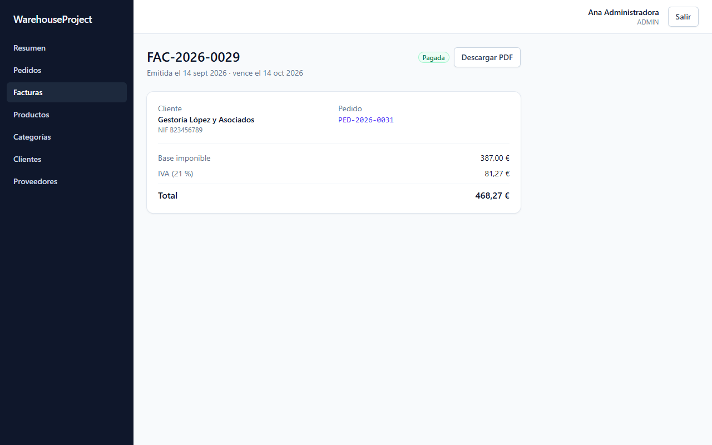
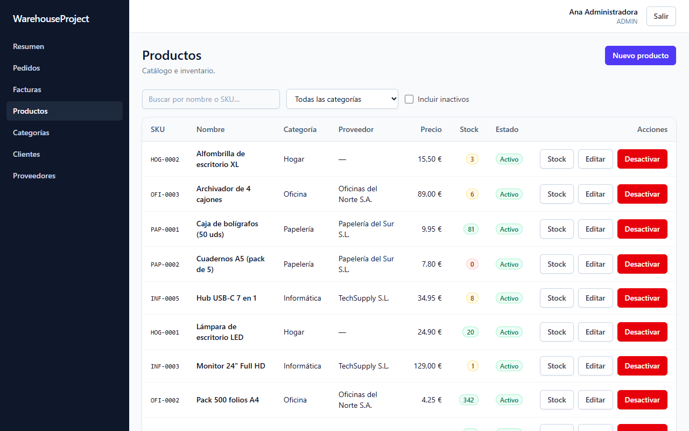
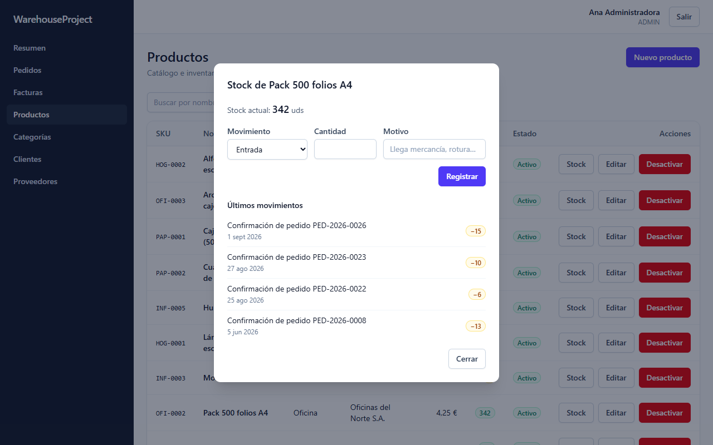
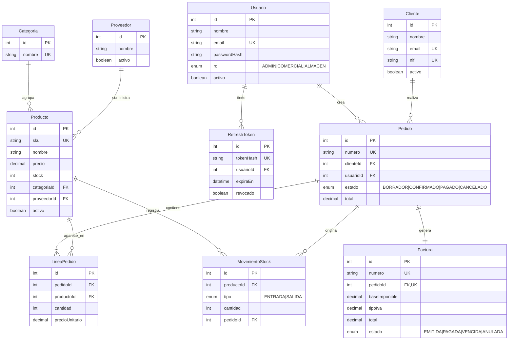

# WarehouseProject

🌐 **[English version](README.en.md)** · Versión en castellano (esta página)

[](https://github.com/Paul-Gomez/WarehouseProject/actions/workflows/ci.yml)

ERP ligero para una tienda o almacén pequeño: catálogo e inventario con libro de movimientos,
clientes y proveedores, pedidos con varias líneas que descuentan stock de forma atómica,
facturación con IVA y PDF, usuarios con roles y un panel con las métricas del negocio.

Es el proyecto principal de mi portfolio: una aplicación completa (API REST + SPA) con
base de datos relacional, tests de integración, Docker y CI.



## Funcionalidades

- **Autenticación JWT** con access token de 15 min y refresh token que se rota en cada uso.
- **Tres roles** (ADMIN, COMERCIAL, ALMACEN): todos consultan, y cada rol escribe solo en lo
  que le toca. El backend lo valida siempre; el frontend esconde lo que no puedes hacer.
- **Catálogo**: productos, categorías y proveedores, con búsqueda, filtros, paginación y
  borrado lógico (lo que tiene historial no se borra, se desactiva).
- **Inventario**: cada entrada o salida de stock queda en un libro de movimientos, así que el
  stock siempre se puede explicar. Almacén registra reposiciones, mermas y ajustes.
- **Pedidos**: borrador → confirmado → pagado (o cancelado). Al confirmar se descuenta el stock
  de todas las líneas en una sola transacción; al cancelar se devuelve.
- **Facturas**: se emiten desde un pedido, guardan base, IVA y total, se descargan en PDF y
  pasan solas a *vencidas* cuando se pasa la fecha de cobro.
- **Resumen**: ventas e ingresos del mes, pendiente de cobro, ventas de 6 meses, productos más
  vendidos, stock bajo y pedidos por estado.

## Capturas

| | |
|---|---|
|  |  |
|  |  |
|  |  |

## Stack

| Capa          | Tecnología                                                          |
| ------------- | ------------------------------------------------------------------- |
| Backend       | Node.js · Express 5 · TypeScript (modo estricto)                    |
| Base de datos | PostgreSQL 16 · Prisma                                              |
| Validación    | Zod (en backend y frontend)                                         |
| Seguridad     | JWT · bcrypt · helmet · límite de intentos de login · CORS          |
| Frontend      | React 19 · TypeScript · Vite · Tailwind CSS                         |
| Estado        | TanStack Query (datos del servidor) · Context (sesión)              |
| Formularios   | React Hook Form + Zod                                               |
| Gráficas      | Recharts                                                            |
| PDF           | pdfkit                                                              |
| Tests         | Jest · Supertest (contra PostgreSQL real) · Vitest en el frontend   |
| Contenedores  | Docker · Docker Compose · nginx                                     |
| CI            | GitHub Actions (lint, formato, tipos, tests, build e imágenes)      |
| Despliegue    | Render (API + PostgreSQL) · Vercel (frontend)                       |

## Arquitectura

```
warehouse-project/
├── backend/            API REST
│   ├── prisma/         schema, migraciones y seed
│   ├── src/
│   │   ├── modules/    un módulo por recurso: routes → controller → service → repository
│   │   ├── middlewares/  autenticación, roles, validación, errores, límite de login
│   │   └── config/     variables de entorno (validadas con Zod) y Prisma
│   └── tests/          tests de integración con Supertest
├── frontend/           SPA de React
│   └── src/
│       ├── api/        hooks de React Query por recurso
│       ├── pages/      una carpeta por pantalla
│       └── components/ componentes reutilizables (tabla, modal, paginación…)
├── docs/capturas/
└── docker-compose.yml  PostgreSQL + API + frontend con nginx
```

- **Capas en el backend.** Las rutas solo encadenan middlewares; el controller traduce HTTP;
  el service tiene la lógica de negocio y abre las transacciones; el repository es el único que
  habla con Prisma. Los repositories reciben el cliente de la transacción, así el service
  decide qué va junto en una transacción sin que el repository lo sepa.
- **Errores centralizados.** Todo error acaba en un único middleware que devuelve siempre el
  mismo formato: errores de Zod → 400, de negocio → 404/409, y los de Prisma (clave única,
  clave foránea) traducidos, nunca un stacktrace.
- **Monorepo sin workspaces**: dos proyectos npm independientes en un mismo repositorio.

## Decisiones técnicas destacadas

- **Stock sin condiciones de carrera.** Se descuenta con un único
  `UPDATE … SET stock = stock - n WHERE stock >= n`, y los cambios de estado con
  `UPDATE … WHERE estado = X`. Si dos personas confirman a la vez el último producto, una gana
  y la otra recibe un 409: el stock nunca queda negativo. Hay un test que lo comprueba lanzando
  las dos peticiones a la vez.
- **Todo o nada.** Confirmar un pedido es una sola transacción: si a una línea le falta stock
  se deshace todo, incluido lo ya descontado de las líneas anteriores.
- **Sin interbloqueos.** Las líneas se procesan siempre ordenadas por producto, así dos pedidos
  que comparten productos bloquean las filas en el mismo orden.
- **Numeración correlativa** (`PED-2026-0001`, `FAC-2026-0001`) bajo un *advisory lock* de
  PostgreSQL, para que dos altas simultáneas no obtengan el mismo número.
- **Dinero en `NUMERIC`**, nunca en coma flotante, y redondeo explícito del IVA.
- **Snapshots**: cada línea guarda el precio del momento y cada factura sus importes, así el
  histórico no cambia aunque cambien los precios o el IVA.
- **Refresh token rotado y guardado como hash.** Cada refresh token sirve una vez; si alguien
  roba uno y lo usa, el siguiente refresh del usuario legítimo falla. En el frontend, si varias
  peticiones caducan a la vez, comparten una única renovación.
- **Rendimiento del frontend**: cada página se descarga al visitarla (el bundle inicial pasó de
  885 kB a 350 kB; Recharts solo se baja al abrir el resumen).

## Modelo de datos



Schema completo: [`backend/prisma/schema.prisma`](backend/prisma/schema.prisma). Los nombres
del modelo están en castellano a propósito: es el idioma del dominio del negocio.

## API

Todas las rutas (salvo login, refresh y logout) exigen `Authorization: Bearer <accessToken>`.
Leer está permitido a cualquier usuario autenticado; escribir depende del rol.

| Recurso                                   | Endpoints principales                                                        | Escriben               |
| ----------------------------------------- | ---------------------------------------------------------------------------- | ---------------------- |
| Autenticación                             | `POST /api/auth/login` · `refresh` · `logout` · `GET /api/auth/yo`           | —                      |
| Usuarios                                  | `POST /api/auth/registrar` (no hay registro público)                         | ADMIN                  |
| Categorías                                | CRUD en `/api/categorias`                                                    | ADMIN                  |
| Proveedores y clientes                    | CRUD en `/api/proveedores` y `/api/clientes`                                 | ADMIN, COMERCIAL       |
| Productos                                 | CRUD en `/api/productos`                                                     | ADMIN, ALMACEN         |
| Stock                                     | `GET`/`POST /api/productos/:id/movimientos`                                  | ADMIN, ALMACEN         |
| Pedidos                                   | CRUD en `/api/pedidos` · `POST /:id/confirmar` · `/pagar` · `/cancelar`      | ADMIN, COMERCIAL       |
| Facturas                                  | `GET /api/facturas` · `POST /api/facturas` · `/:id/anular` · `GET /:id/pdf`  | ADMIN, COMERCIAL       |
| Resumen                                   | `GET /api/dashboard`                                                         | —                      |

Los listados aceptan `page` y `pageSize` y devuelven `{ data, meta: { page, pageSize, total, totalPages } }`.

## Puesta en marcha

### Con Docker (todo el stack)

Requisitos: Docker.

```bash
docker compose up -d --build
docker compose --profile seed run --rm seed   # datos de prueba
```

Abre http://localhost:8080. Usuarios de prueba (contraseña `Password123!`):
`admin@warehouseproject.dev`, `comercial@warehouseproject.dev` y `almacen@warehouseproject.dev`.

La API aplica las migraciones al arrancar y nginx sirve el frontend y reenvía `/api` al backend.

### En local (para desarrollar)

Requisitos: Node.js 20.12+ y Docker (solo para PostgreSQL).

```bash
docker compose up -d postgres

cd backend
npm install
cp .env.example .env          # y genera tus propios secretos JWT
npm run prisma:migrate
npm run prisma:seed
npm run dev                   # http://localhost:3000

cd ../frontend
npm install
npm run dev                   # http://localhost:5173 (reenvía /api al backend)
```

Las variables de entorno están documentadas en [`backend/.env.example`](backend/.env.example)
y se validan con Zod al arrancar: si falta alguna, la API no arranca y dice cuál.

## Tests

```bash
cd backend
npm test
```

36 tests de integración con Supertest contra una base de datos PostgreSQL de pruebas
(`warehouseproject_test`, se crea y migra sola): autenticación y roles, rotación de tokens,
pedidos (rollback, concurrencia, numeración), stock, facturas, vencimientos y PDF.

```bash
cd frontend
npm test
```

Tests unitarios con Vitest de la lógica pura del frontend (por ahora, el formato de importes).
Las pantallas se han revisado a mano en 360, 768, 1024, 1280 y 1440 px.

## CI

Cada push ejecuta en GitHub Actions: lint, formato, comprobación de tipos, tests (con un
PostgreSQL de servicio) y build del backend; lint, formato, tipos, tests y build del frontend;
y la construcción de las dos imágenes Docker.

## Despliegue

- **API + base de datos en Render**: el repositorio incluye un blueprint
  ([`render.yaml`](render.yaml)). En Render: *New → Blueprint* y elegir el repositorio. Crea la
  base de datos, genera los secretos JWT y despliega la imagen Docker del backend.
- **Frontend en Vercel**: importar el repositorio con `frontend` como directorio raíz y definir
  `VITE_API_URL` con la URL pública de la API. [`frontend/vercel.json`](frontend/vercel.json)
  hace que las rutas de la SPA funcionen al recargar.
- Por último, en Render, poner en `CORS_ORIGIN` la URL de Vercel.

## Roadmap

- [x] **Fase 0** — Setup inicial (estructura, TypeScript, ESLint + Prettier)
- [x] **Fase 1** — Modelado de datos (diagrama ER, Prisma, migraciones, seed)
- [x] **Fase 2** — CRUD de catálogo con arquitectura por capas
- [x] **Fase 3** — Autenticación JWT y autorización por rol
- [x] **Fase 4** — Pedidos, descuento de stock atómico y facturación
- [x] **Fase 5** — Frontend base (layout, rutas protegidas, login)
- [x] **Fase 6** — CRUD en el frontend con paginación y filtros
- [x] **Fase 7** — Resumen con métricas y gráficas
- [x] **Fase 8** — PDF de facturas, movimientos de stock, tests, Docker y CI
- [x] **Fase 9** — Seguridad para producción, despliegue y documentación

### Ideas para seguir

- Facturas rectificativas (ahora una factura anulada no se puede volver a emitir).
- Búsqueda remota en los selectores del formulario de pedido (hoy cargan hasta 100 elementos).
- Tests end-to-end del frontend (Playwright).

## Licencia

MIT
